# Mi Edificio

[](https://github.com/Ctuna89/mi-edificio/actions/workflows/ci.yml) [](LICENSE)

App web para residentes, conserjería, comité, administración y empresas de mantención de un edificio. Gratis y de código abierto.

Se instala **en un computador del propio edificio**: un solo programa sirve la app, guarda la base de datos y los archivos en una carpeta, y no depende de ningún servicio en la nube. Una instalación = un edificio.

| | |
|---|---|
| 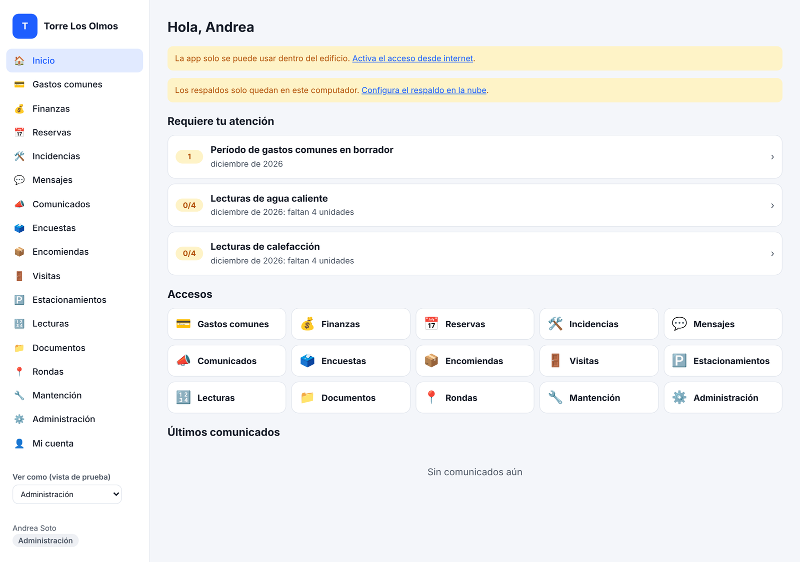 | 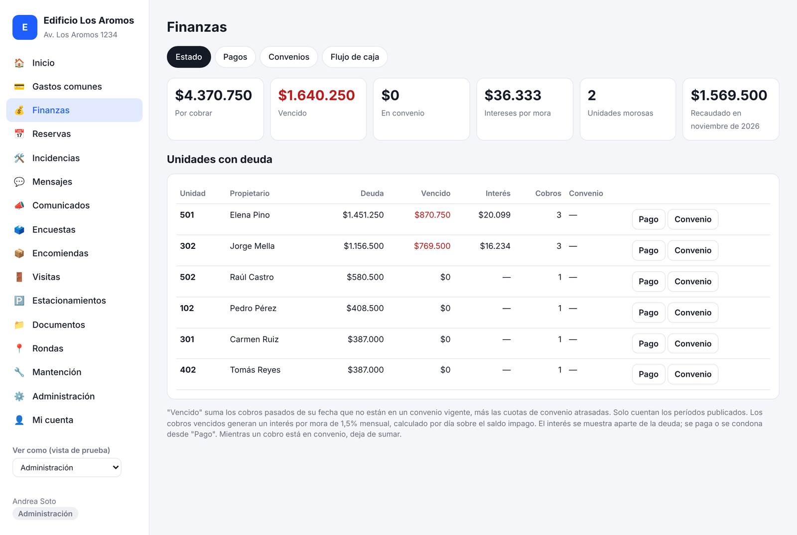 |
| 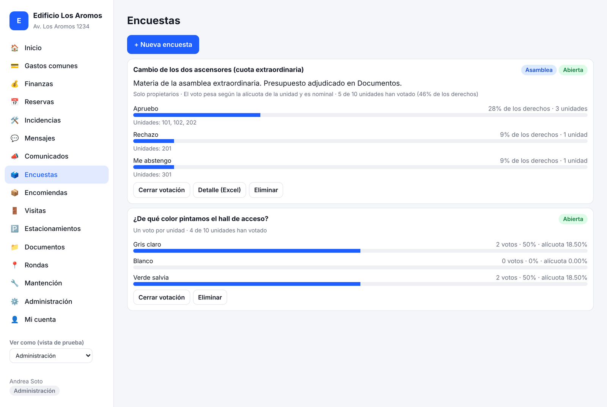 | 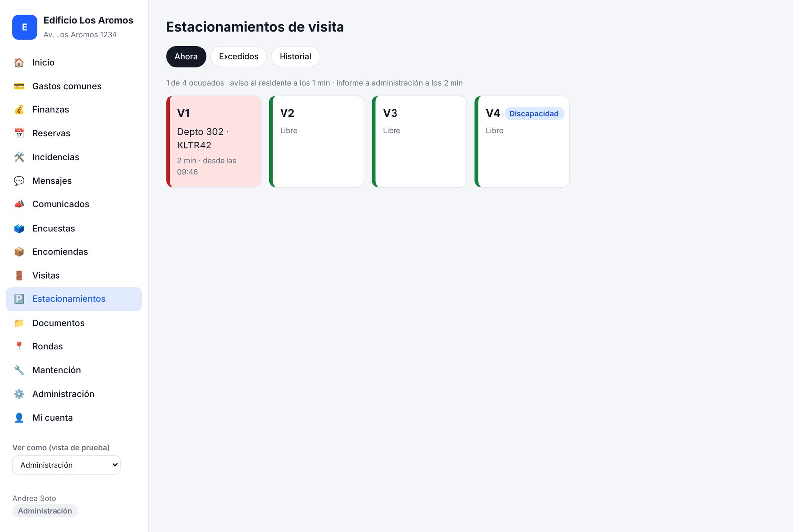 |
| 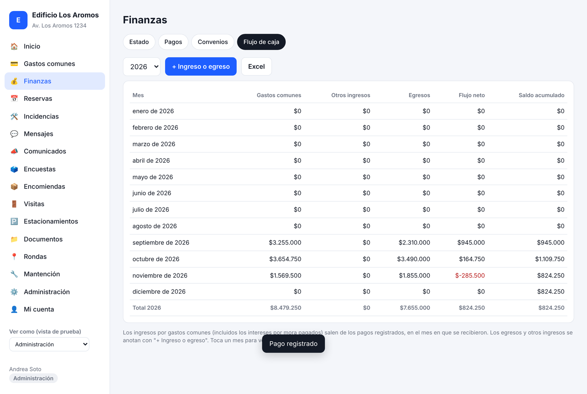 | 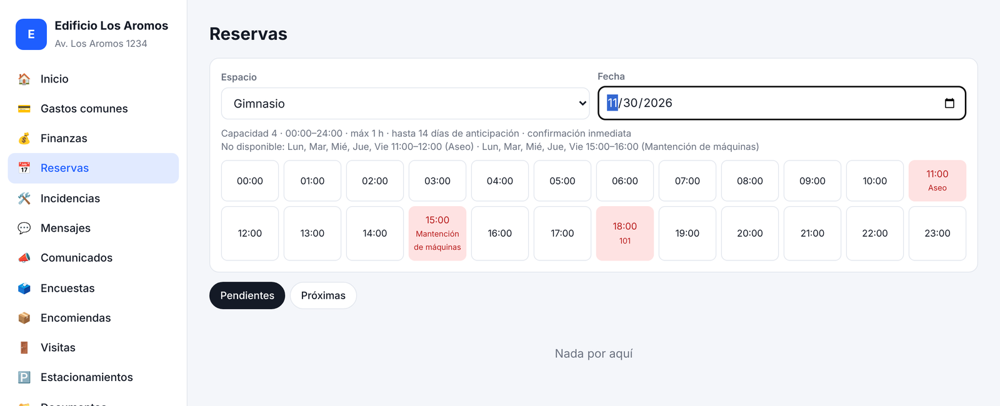 |
| 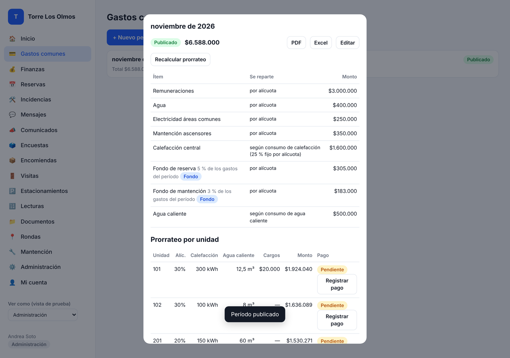 | 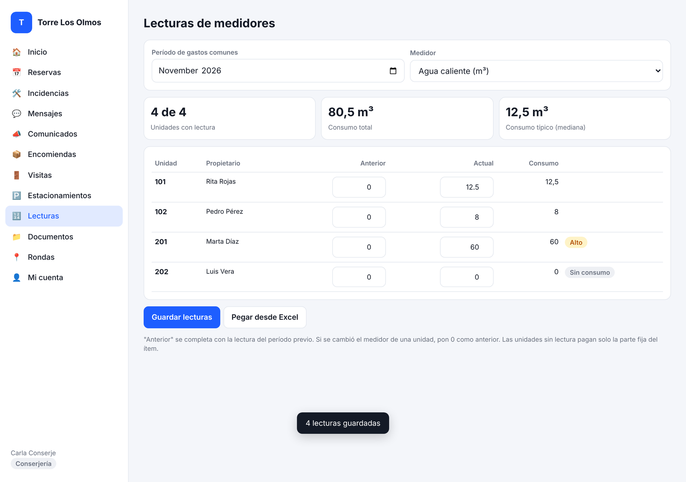 |
| 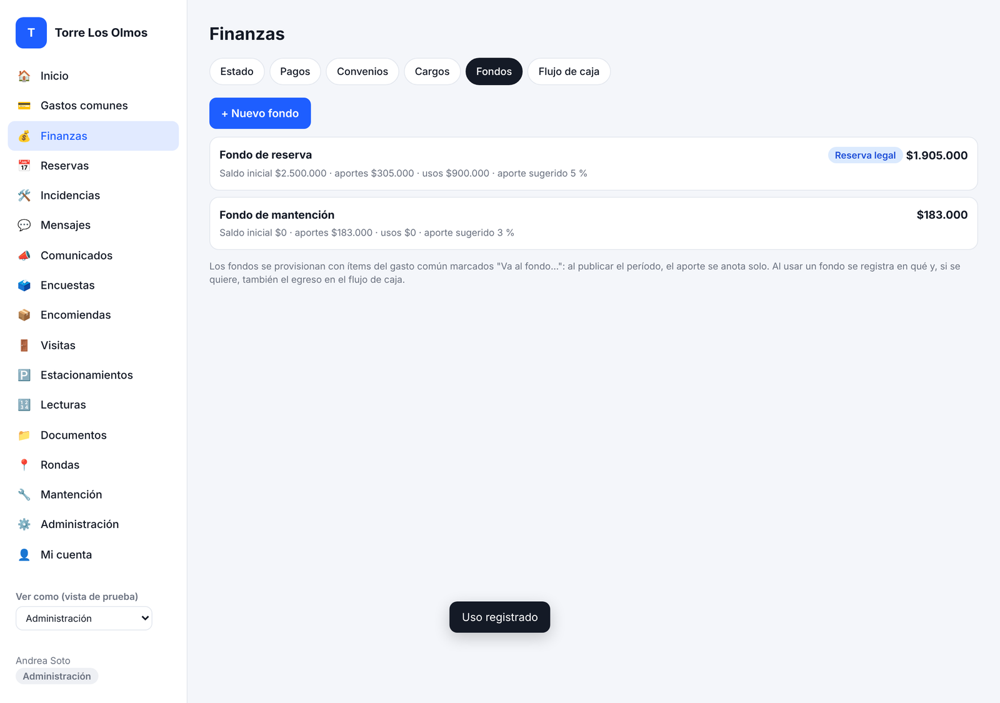 | |

En el teléfono de un residente:

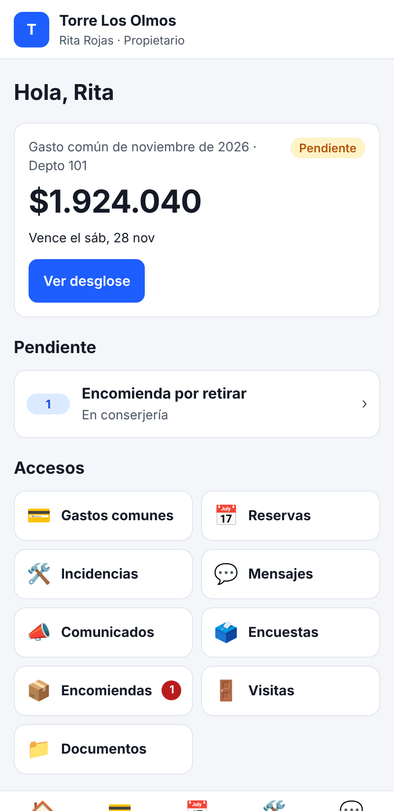 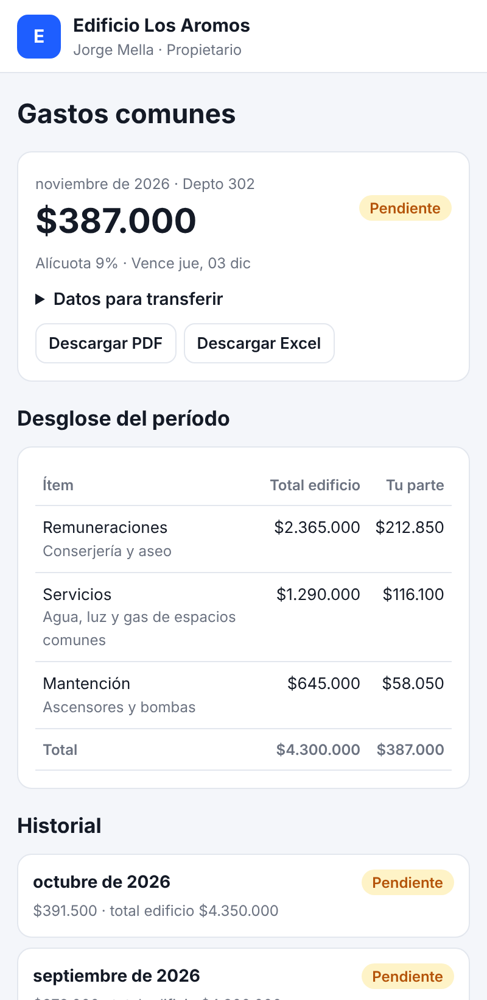 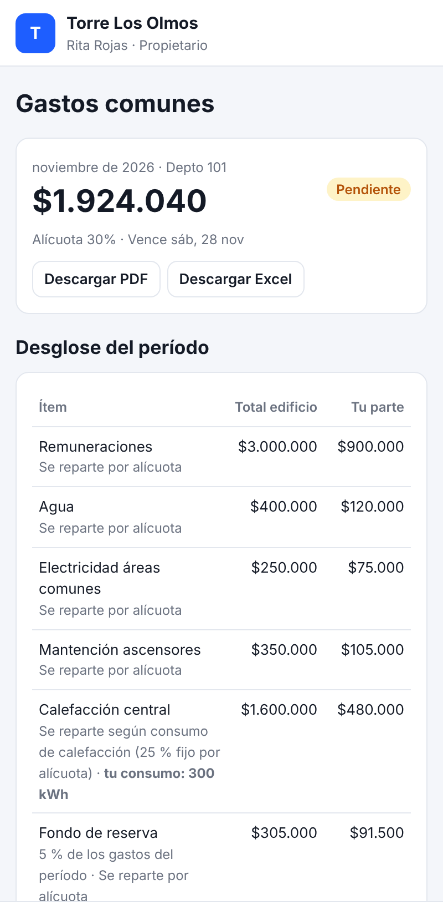

Las capturas son de un edificio de demostración con datos inventados.

```
mi-edificio/
├── instalador/          ← instalador de Windows (se construye con construir.sh)
├── local/               ← servidor local: lo único que hay que ejecutar
│   ├── server.mjs       ← sirve la app, la base de datos, las cuentas y los archivos
│   ├── cliente.js       ← conexión del navegador con el servidor
│   ├── base.sql         ← cuentas, archivos y cola de avisos
│   ├── lanzar.mjs       ← lo inicia en segundo plano, lo abre o lo detiene
│   ├── iniciar.bat / iniciar.sh
│   └── datos/           ← se crea al iniciar: base de datos, archivos, respaldos (no va al repositorio)
├── web/                 ← la app (HTML y JS sin build)
└── supabase/
    ├── schema.sql       ← tablas, permisos por rol y reglas de negocio (se aplica solo al iniciar)
    ├── functions/push/  ← solo para la instalación alternativa en Supabase
    └── tests/           ← pruebas de permisos
```

## 1. Instalar en un computador del edificio

Elige un computador que quede encendido, como el de conserjería o administración.

### Windows

1. Descarga `MiEdificio-Instalar-<versión>.exe` desde [Releases](https://github.com/Ctuna89/mi-edificio/releases/latest).
2. Ábrelo y sigue el asistente. Lo primero que pregunta es **dónde va a funcionar**: *en este computador* (lo simple y recomendado; el computador debe quedar encendido) o *en la nube* (más complejo: el instalador no lo hace, abre la [guía de Supabase](#instalación-alternativa-supabase) y termina sin instalar nada). Eligiendo este computador: aceptar la licencia, elegir si parte junto con Windows (recomendado) y si quieres el ícono en el escritorio, e instalar. No pide permisos de administrador ni instalar nada más: trae incluidos Node.js y el programa para el acceso desde internet.
3. Al terminar se abre la app en el navegador, en `http://localhost:8080`.

Cosas que conviene saber:

- **Windows mostrará una advertencia** ("Windows protegió su PC" o "editor desconocido") porque el instalador no está firmado digitalmente. Hay que elegir *Más información → Ejecutar de todas formas*. Descárgalo solo desde este repositorio.
- Si el Firewall pregunta por el acceso a la red, permítelo en redes privadas para que otros equipos del edificio puedan entrar.
- Quedan en el menú Inicio **Abrir Mi Edificio**, **Detener Mi Edificio** y **Desinstalar**. El servidor corre en segundo plano, sin ventana.
- "Iniciar junto con Windows" lo arranca cuando **ese usuario inicia sesión**. Si el computador se reinicia y nadie entra a la sesión, la app no parte: configura el inicio de sesión automático o deja la sesión abierta.
- Los datos quedan en `%LOCALAPPDATA%\MiEdificio\datos`. **Desinstalar** no borra los datos. Para actualizar, ver "Actualizar" más abajo.

### Mac o Linux

Con [Node.js](https://nodejs.org) 20 o superior instalado, descarga este repositorio (**Code → Download ZIP** o `git clone`) y ejecuta:

```bash
./local/iniciar.sh
```

La primera vez descarga sus dependencias (necesita internet) y crea la carpeta `local/datos`. Abre la dirección que muestra, por ejemplo `http://localhost:8080`. Para dejarlo en segundo plano: `node local/lanzar.mjs iniciar` (y `detener` para pararlo).

### En ambos casos

La app ya funciona en ese computador y, por la dirección de red que muestra el servidor, en los equipos conectados a la red del edificio. Para que residentes y conserjes entren desde sus teléfonos, sigue con el paso 2.

Para cambiar el puerto, crea un archivo `puerto.txt` con el número en la carpeta de datos (o define la variable `PUERTO`) y reinicia.

## 2. Acceso desde internet

Los residentes entran desde fuera del edificio, y la cámara (QR de visitas) y las notificaciones exigen una dirección **HTTPS**. Mi Edificio lo resuelve con un túnel de [Cloudflare](https://developers.cloudflare.com/cloudflare-one/connections/connect-networks/): un programa (`cloudflared`) que publica el servidor en una dirección segura sin abrir puertos del router. Los datos siguen en tu computador; el túnel solo los transporta.

Necesitas un **dominio** propio (comprarlo cuesta unos US$10 al año) y una **cuenta gratuita en Cloudflare**. Se configura una vez, desde la app, en el asistente inicial (paso "Acceso desde internet") o en **Administración → Edificio → Acceso desde internet**:

1. Crea la cuenta en Cloudflare y agrega tu dominio.
2. En el panel, entra a *Zero Trust → Networks → Tunnels* y crea un túnel de tipo *Cloudflared*.
3. Cloudflare muestra un comando con un token largo que empieza con `eyJ`. Cópialo y pégalo en la app; no hace falta ejecutarlo.
4. En *Public Hostname* elige la dirección, por ejemplo `app.miedificio.cl`, y como servicio `http://localhost:8080`.
5. Escribe esa dirección en la app y pulsa **Conectar**.

El servidor inicia el túnel solo cada vez que arranca, lo reconecta si se cae, y avisa en Inicio si deja de funcionar. Con el acceso activo, el enlace para invitar a la comunidad usa esa dirección.

La app no ofrece las direcciones temporales gratuitas de Cloudflare (`trycloudflare.com`): cambian en cada reinicio y no tienen garantía de disponibilidad, así que no sirven para una comunidad.

- **Windows**: `cloudflared` viene incluido en el instalador.
- **Mac o Linux**: instálalo aparte (ver la documentación de Cloudflare) y déjalo en el `PATH`.

Los nombres de las secciones del panel de Cloudflare pueden cambiar. La conexión real con Cloudflare **no está probada por el proyecto**: se probó cómo el servidor maneja el programa (arranque, token, errores, reconexión), no un túnel funcionando. Si lo configuras, cuéntanos cómo te fue.

Cualquier otro túnel o proxy inverso con HTTPS también sirve, siempre que reenvíe la cabecera `X-Forwarded-Proto`. Abrir un puerto del router rara vez es opción: muchos proveedores no entregan una IP pública propia.

## 3. Primer uso

1. Abre la app → **Crear cuenta** → **Configura tu edificio**. La primera cuenta crea el edificio y queda como su **administrador**.
2. Se abre el **asistente de configuración**, 9 pasos: datos del edificio, unidades y alícuotas, datos bancarios, espacios comunes, visitas y estacionamientos, datos personales, acceso desde internet, respaldo en la nube e invitación. Se guarda al avanzar. Puedes dejarlo y retomarlo desde Inicio o Administración → Edificio.
3. Comparte la dirección de la app (la de internet, si la activaste) con residentes y conserjes. Cada persona crea su cuenta y queda **pendiente**: aparece en Administración → Usuarios, donde le asignas depto y rol y la activas.

Como administrador tienes el selector **"Ver como"** para revisar la interfaz de cada rol (solo cambia la vista, no tus permisos).

**Contraseñas olvidadas.** No hay correo de recuperación: la administración fija una nueva en Administración → Usuarios → "Nueva contraseña" y se la entrega a la persona, que después la cambia en Mi cuenta. Si quien la olvida es el único administrador, no hay forma de recuperarla desde la app: conviene tener dos.

## 4. Respaldos y mantención

Todo lo de tu edificio está en la carpeta de datos: `%LOCALAPPDATA%\MiEdificio\datos` si usaste el instalador de Windows, o `local/datos` en los demás casos.

| Carpeta | Contenido |
|---|---|
| `db/` | Base de datos |
| `archivos/` | Fotos y documentos subidos |
| `respaldos/` | Copia local de la base de datos de cada día (últimos 14), a la hora del respaldo, y una al detener el servidor |
| `config.json` | Claves propias de esta instalación (no lo compartas) |

### Actualizar

La app revisa una vez al día si hay una versión nueva y le avisa a la administración en Inicio y en **Administración → Edificio → Versión y actualizaciones**.

- **Windows (con el instalador)**: botón **Actualizar ahora**. Descarga el instalador de la versión nueva, comprueba su suma de verificación, detiene el servidor, reemplaza el programa y lo vuelve a iniciar. La app deja de responder unos minutos. También sirve instalar la versión nueva encima, a mano.
- **Mac o Linux**: detén el servidor, reemplaza los archivos del repositorio por los de la versión nueva (sin tocar `local/datos`) e inícialo.

Cómo se protegen los datos, en cualquier sistema:

1. **Copia previa**: antes de que una versión distinta toque la base de datos, se guarda una copia completa en `respaldos/antes-de-actualizar-…` (se conservan las 5 últimas).
2. **Todo o nada**: los cambios de la base de datos se aplican en una sola operación. Si algo falla, se deshacen completos y los datos quedan exactamente como estaban.
3. **Si falla, la app no arranca a medias**: muestra una página de mantención que, abierta en el computador del edificio, explica qué pasó y qué versión volver a instalar para seguir funcionando como antes. Desde fuera solo se ve un aviso general.
4. **No se puede retroceder por accidente**: la base recuerda qué versión la actualizó. Un programa más antiguo no la abre; indica qué versión instalar.

Para volver a una versión anterior después de una actualización que sí funcionó, hay que restaurar la copia previa (se pierde lo hecho desde entonces): detén el servidor, mueve la carpeta `db/`, instala la versión anterior e inicia con `--restaurar` y esa copia.

Límite: la actualización con un clic confía en lo publicado en GitHub. La suma de verificación detecta descargas dañadas, no una publicación maliciosa; el instalador no está firmado.

### Respaldo en la nube

Para que una falla del computador no se lleve todo, Mi Edificio deja cada día una copia **cifrada** de la base de datos, las fotos y los documentos en una carpeta que tú eliges. Si esa carpeta pertenece a una nube, su aplicación la sube sola:

1. Instala en el computador del edificio la app de **OneDrive**, **Google Drive**, Dropbox o iCloud e inicia sesión en ella.
2. En el asistente inicial (paso "Respaldo en la nube") o en **Administración → Edificio → Respaldo en la nube**, elige la carpeta. La app propone las carpetas de nube que encuentra en el computador; también puedes escribir la ruta, por ejemplo `C:\Users\Conserjeria\OneDrive\Respaldo Mi Edificio`.
3. Define la **contraseña del respaldo** y anótala fuera del computador. Sin ella el respaldo no se puede abrir, y nadie puede restablecerla.
4. Elige la **hora del respaldo diario** (por defecto 03:00, según el reloj del computador). Mientras se respalda, la app puede dejar de responder unos minutos, así que conviene una hora de poco uso. Si el computador está apagado a esa hora, el respaldo se hace cuando vuelva a encenderse ese mismo día.

Si la carpeta no parece estar dentro de una nube, la app lo advierte: el respaldo se haría igual, pero quedaría solo en ese computador. La advertencia se basa en el nombre de la ruta, así que confirma en la app de tu nube que la carpeta realmente se está sincronizando. Inicio avisa a la administración si no hay respaldo configurado, si el último falló o si lleva más de 3 días sin hacerse.

**Restaurar en un computador nuevo**: instala Mi Edificio y la app de tu nube, espera a que baje la carpeta y ejecuta

```bash
./local/iniciar.sh --restaurar-nube "/ruta/a/Respaldo Mi Edificio"
```

En Windows con el instalador, abre una ventana de comandos y ejecuta:

```bat
"%LOCALAPPDATA%\Programs\Mi Edificio\node.exe" "%LOCALAPPDATA%\Programs\Mi Edificio\local\server.mjs" --restaurar-nube "C:\ruta\Respaldo Mi Edificio"
```

(define antes `set MI_EDIFICIO_DATOS=%LOCALAPPDATA%\MiEdificio\datos`). Este comando en Windows no está probado. Pide la contraseña del respaldo y recupera cuentas, datos y archivos. Después vuelve a configurar el respaldo en Administración.

### Otras tareas

- **Copia manual**: con el servidor detenido, la carpeta `local/datos` completa es un respaldo sin cifrar.
- **Restaurar solo la base de datos** desde una copia diaria local: con la carpeta `db/` vacía,

  ```bash
  ./local/iniciar.sh --restaurar local/datos/respaldos/mi-edificio-AAAA-MM-DD.tar.gz
  ```

- **Si el computador se apaga** o se corta internet, la app deja de responder hasta que vuelva. Conviene configurar que el servidor parta al encender el equipo.

Límites: está pensada para un edificio. La base de datos atiende una consulta a la vez, lo que alcanza de sobra para ese tamaño, y usa PGlite, un Postgres embebido todavía joven.

## Módulos

| Módulo | Residente / Propietario | Conserje | Comité | Admin | Empresa mantención |
|---|---|---|---|---|---|
| Gastos comunes (desglose, prorrateo por alícuota o consumo, PDF/Excel) | ve su aviso de cobro con sus consumos | – | ve todo y exporta | edita, registra pagos, exporta | – |
| Lecturas de medidores (agua caliente, calefacción, gas…) | ve las suyas en su desglose | ingresa | ve | configura, ingresa | – |
| Suspensión de luz por morosidad (con resguardos legales) | ve el aviso previo; declara condiciones especiales | consulta condiciones especiales en emergencias | aprueba cada unidad | propone, avisa, solicita y repone | – |
| Asambleas: citación, poderes, quórum, votaciones y acta | da poderes, registra su asistencia y vota | – | convoca y conduce la mesa | convoca y conduce la mesa | – |
| Registro de copropietarios, arrendatarios y ocupantes | el propietario informa cambios y confirma cada año | – | ve todo | mantiene el registro | – |
| Seguros: pólizas del edificio y documentos de cada unidad | el propietario sube los de su unidad | – | ve todo | gestiona pólizas y revisa documentos | – |
| Multas con debido proceso (cargos, descargos, resolución) | ve los casos de su unidad y presenta descargos | abre casos | aprueba multas, abre casos | formula cargos, resuelve, configura el catálogo | – |
| Finanzas: pagos, morosidad, convenios, cargos, fondos y flujo de caja | ve su estado de cuenta y los saldos de los fondos, acepta convenios | – | ve todo | registra pagos, cargos y usos de fondos, propone convenios, anota egresos | – |
| Reservas de áreas comunes | reserva / cancela | ve agenda | aprueba | aprueba, configura | – |
| Incidencias con fotos | reporta, cierra las suyas | gestiona, se asigna | gestiona | gestiona, crea OT | ve las ligadas a sus OT |
| Mensajes (canales conserjería / comité / administración) | chat por canal | canal conserjería | canal comité | todos | – |
| Comunicados | lee | lee | publica | publica | lee |
| Encuestas y votaciones de asamblea | vota, ve resultados | – | crea, cierra, ve totales | crea, cierra, ve totales | – |
| Documentos (reglamento, actas, balances) | lee | lee | sube | sube | – |
| Encomiendas | ve las suyas | registra / entrega | – | registra / entrega | – |
| Visitas con QR | anuncia y comparte el QR | escanea, registra ingreso/salida | – | escanea, registra | – |
| Estacionamientos de visita | ve el de su visita | ocupa / libera | ve, recibe excesos | define, ocupa / libera, recibe excesos | – |
| Rondas NFC y bitácora (cumplimiento diario) | – | registra | ve | registra, ve | – |
| Mantención: activos, plan preventivo, OT | – | – | ve | crea, aprueba | acepta, agenda, ejecuta, cierra |
| Administración (edificio, usuarios, unidades, espacios, estacionamientos, activos, empresas) | – | – | – | ✔ | – |

La seguridad está en la base de datos (permisos por rol y reglas en `schema.sql`), no en el navegador: aunque alguien modifique el JS, solo puede leer y escribir lo que su rol permite.

## Cálculo de los gastos comunes

Cada período tiene sus ítems (remuneraciones, agua, calefacción…) y **cada ítem dice cómo se reparte**:

- **Por alícuota**: lo normal. Cada unidad paga según su alícuota (Administración → Unidades).
- **En partes iguales** entre todas las unidades.
- **Según consumo**: con las lecturas de un medidor individual (agua caliente, calefacción, gas, lo que tenga el edificio). Se puede indicar un **% fijo por alícuota** para la parte que no depende del consumo (pérdidas de la caldera, mantención del equipo, áreas comunes); el resto se reparte en proporción al consumo de cada unidad. Ejemplo: calefacción central de $1.600.000 con 25 % fijo → $400.000 por alícuota y $1.200.000 según los kWh de cada unidad.
- **Solo a algunas unidades**: en partes iguales entre las que se indiquen (por ejemplo, un gasto de una sola torre o piso).

Cada ítem se redondea al peso y la diferencia de redondeo se asigna a las unidades con mayor fracción: **la suma de las unidades cuadra exactamente con el total**. El cobro de cada unidad guarda su desglose, que el residente ve con sus consumos y descarga en su aviso de cobro (PDF o Excel); el Excel de la administración trae el prorrateo ítem por ítem.

**Lecturas de medidores.** En el módulo **Lecturas**, la administración define qué medidores tiene cada unidad y conserjería (o la administración) ingresa cada mes, por medidor, **el número que marca el medidor** de cada unidad. El consumo es la diferencia con la lectura del mes anterior, que la app toma sola (solo la primera lectura de una unidad se ingresa a mano), y **nunca puede ser negativo**: una lectura menor que la del mes pasado no se acepta. Si se corrige una lectura, el mes siguiente se actualiza solo. **Cambio de medidor**: se marca en la fila de la unidad y se indican la última lectura del medidor retirado y la inicial del nuevo (normalmente 0); el consumo del mes es (retirado − mes anterior) + (actual − inicial del nuevo), y el mes siguiente parte de la lectura del medidor nuevo. También se pueden **pegar desde Excel** (unidad y lectura). La app marca consumos en cero o muy por sobre lo típico, para revisar errores de lectura. Al guardar un período con ítems según consumo, avisa cuántas unidades tienen lectura; **no deja publicar un ítem según consumo sin lecturas**, y una vez publicado el período sus lecturas ya no se pueden cambiar (para corregir, se despublica). Una unidad sin lectura paga solo la parte fija.

**Fondos.** En Finanzas → Fondos se crean el **fondo común de reserva** (la Ley de Copropiedad Inmobiliaria exige formarlo; el porcentaje lo fija el reglamento dentro del mínimo legal, confírmalo) y otros, como uno de mantención. Cada fondo tiene un aporte sugerido en % de los gastos del período y su saldo al empezar a usar la app. Al crear un período se agrega el ítem de cada fondo y **"Calcular aportes a fondos"** calcula su monto. Al publicar el período, el aporte se anota solo en el fondo (y se quita si se despublica). Para **usar un fondo** se registra en qué y cuánto, y si se quiere también el egreso en el flujo de caja; no se puede usar más que el saldo. Los ajustes (intereses del banco, diferencias) se anotan aparte. La comunidad ve los saldos.

**Cargos individuales.** Multas, arriendo de espacios comunes y otros cobros a una unidad se registran en Finanzas → Cargos y **se suman al gasto común de esa unidad** en el período indicado (por defecto, el primero sin publicar; no se pueden agregar a uno publicado). El **arriendo** se carga solo al aprobarse la reserva de un espacio con costo, y se anula solo si la reserva se cancela. Desde Estacionamientos → Excedidos se puede **cursar una multa** con los datos del uso. Un cargo no se borra: se **rebaja o se anula (condonación) con un motivo**, y queda el registro de multas condonadas o rebajadas.

## Asambleas

En el módulo **Asambleas**, la administración o el comité crean la asamblea (ordinaria, extraordinaria de mayoría absoluta o reforzada; presencial, telemática o mixta) con su tabla, y la app acompaña cada paso:

- **Citación** entre 5 y 15 días antes (configurable): aviso a copropietarios y residentes, y citación imprimible con tabla, quórum y reglas de representación.
- **Poderes simples**: el copropietario designa a alguien para esa asamblea (con o sin cuenta en la app), lo imprime y puede revocarlo hasta que empiece.
- **Representación del arrendatario**: si el copropietario no asiste ni da poder, lo representa el arrendatario u ocupante, salvo que el copropietario lo haya excluido en el Registro. En materias de mayoría reforzada necesita un poder.
- **Asistencia y quórum en vivo**, ponderado por la alícuota: cada persona registra su asistencia desde la app o la mesa la registra en la sala. Ordinaria: 33 % para constituirse; extraordinaria absoluta: más del 50 %; reforzada: 66 %. Sin quórum no se puede abrir una votación.
- **Votaciones por moción**: votan las unidades presentes y sin cuotas de gasto común impagas, desde la app o como voto presencial registrado por la mesa. El resultado se calcula con la mayoría de cada tipo (mayoría de los derechos presentes, más del 50 % o el 66 % de todos los derechos) y muestra qué votó cada unidad. Los votos no se pueden cambiar ni borrar.
- **Acta**: al terminar, plazo de 30 días para firmarla, con aviso en el inicio; una vez firmada no se modifica. Las unidades que no asistieron se pueden llevar a un caso de multa por inasistencia (Multas), con su procedimiento.

Los porcentajes de quórum y mayoría siguen la especificación de CactusOne para la Ley 21.442; confírmalos con tu reglamento. Adaptado de [CactusOne](https://github.com/Ctuna89/cactusone), con permiso de sus autores. Para consultas fuera de asamblea sigue disponible Encuestas.

## Registro de copropietarios

La Ley 21.442 y su reglamento (Decreto 7, arts. 5 a 7) exigen un **Registro de Copropietarios, Arrendatarios y demás Ocupantes**. En el módulo **Registro**:

- Por cada unidad: copropietarios, arrendatarios y ocupantes con nombre, RUT (validado, sin guardar copia de la cédula), correo (el domicilio para citaciones y notificaciones), domicilio, si es ocupante permanente o transitorio, vigencia del arriendo y, si es una empresa, su representante legal. A los menores no se les pide RUT.
- La administración lo mantiene. Los propietarios **informan los cambios** de su unidad desde la app (quedan por revisar) y **confirman los datos una vez al año**; la administración envía el requerimiento anual con un botón y ve qué unidades confirmaron y a cuáles les falta información.
- Nada se borra: al vender o terminar un arriendo se registra la fecha de término y el historial queda.
- El propietario puede declarar que su arrendatario u ocupante **no** lo representa en asambleas (por ley lo representa si el dueño no asiste ni da poder).
- Es reservado: lo ven la administración y el comité, y cada unidad lo suyo. La exportación a Excel queda en la bitácora. El nombre de los copropietarios vigentes se usa automáticamente en el resto de la app.

## Módulos activables

En Administración → Edificio → **Módulos**, cada módulo opcional puede quedar activo, **solo para el personal** (para probarlo antes de abrirlo a los residentes) o **apagado**. Apagar no borra datos. Inicio, Gastos comunes, Finanzas, Administración y Mi cuenta siempre están. Es un ajuste de la interfaz: los permisos de cada dato siguen en la base de datos.

## Suspensión de luz por morosidad

La Ley 21.442 (art. 20 nº 9) permite suspender o pedir la suspensión del suministro eléctrico de una unidad con deuda de gastos comunes, y los tribunales han anulado cortes que no cumplieron cada requisito. En Finanzas → **Suspensión de luz** la app detecta y prepara, pero **nunca corta sola**, y la base de datos exige cada resguardo:

1. Solo unidades con **3 o más cuotas de gasto común impagas** (continuas o no). No cuentan multas, otros cargos, intereses, períodos en un convenio vigente ni los períodos que se marquen como estado de catástrofe.
2. **Nunca** una unidad donde viva una persona electrodependiente o que use oxígeno medicinal: no se puede proponer, y si se registra durante el proceso, este se cancela solo (o, si ya estaba suspendida, hay que reponer de inmediato).
3. **Aprobación del comité** para cada unidad (por defecto, una aprobación).
4. **Aviso previo** a la unidad con al menos **5 días corridos** (en la app y en un aviso imprimible).
5. Recién después, y comprobando de nuevo deuda y protección, la **solicitud** a la empresa eléctrica (carta imprimible).
6. Con pago o convenio, la **reposición a más tardar el día hábil siguiente**, con orden imprimible y alerta en el inicio. Solo electricidad: el agua nunca se corta.

**Condiciones especiales.** Los residentes declaran en Mi cuenta, con consentimiento expreso, si en su unidad vive alguien electrodependiente, que usa oxígeno medicinal, con movilidad reducida o un adulto mayor que vive solo; la administración puede registrarlo con un consentimiento en papel. Es un registro reservado: lo ven la administración y la propia unidad. Conserjería lo consulta en una emergencia con el botón "🚨 Unidades con condiciones especiales", indicando el motivo, que queda en la bitácora. Revocar el consentimiento termina la condición.

Adaptado de [CactusOne](https://github.com/Ctuna89/cactusone), con permiso de sus autores.

## Seguros

- **Pólizas del edificio**: incendio colectivo (obligatoria por la Ley 21.442, art. 43), responsabilidad civil y otras, con aseguradora, número, coberturas, montos, vigencia y el PDF. Si falta una póliza vigente de un tipo obligatorio, aparece una alerta roja en el inicio de administración y comité; los tipos obligatorios se eligen en Seguros → Ajustes. Se avisa a los 60, 30 y 15 días del vencimiento y cada día de la última semana. Cada póliza guarda sus **siniestros** (reclamado, pagado, estado) y las pólizas anteriores.
- **Documentos de cada unidad**: los propietarios suben su póliza de incendio y sismo, el certificado de dominio u otros, con su vencimiento. La administración los acepta o rechaza con motivo, y ve el % de unidades con póliza vigente acreditada. Al propietario se le avisa 30 días antes de que venza su póliza. Si la póliza colectiva cubre también las unidades, se indica y acreditar una propia es opcional.

Adaptado de [CactusOne](https://github.com/Ctuna89/cactusone), con permiso de sus autores.

## Multas con debido proceso

Una multa no se cobra directo: pasa por un caso con su expediente, que nadie puede borrar.

1. **Apertura**: conserjería, el comité o la administración abren un caso con lo constatado y fotos de evidencia (también desde Estacionamientos → Excedidos). Abrir un caso no es multar.
2. **Cargos**: la administración elige la conducta del **catálogo** (solo se aplican multas del catálogo, en UTM o UF) y la unidad. La notificación de cargos parte de un borrador con los hechos. Si la conducta exige evidencia mínima (por ejemplo, denuncia de dos unidades), hay que confirmarla. La unidad recibe el aviso y puede verlo en la app; la notificación también se imprime para entregarla en papel.
3. **Descargos**: la unidad los presenta en la app dentro del plazo (por defecto 5 días hábiles, sin fines de semana ni feriados), o la administración registra los entregados por escrito.
4. **Resolución fundada**: recién con descargos o con el plazo vencido, la administración absuelve o sanciona, indicando los antecedentes considerados. Si la unidad fue sancionada por la misma conducta en los 6 meses anteriores, se propone la categoría superior o el doble.
5. **Comité**: si así se configura (por defecto, una aprobación), la multa espera la aprobación del comité; si la rechaza, vuelve a la administración.
6. **Cobro**: se convierte a pesos con la UTM o UF vigente y queda como cargo en el próximo gasto común abierto de la unidad. Lo cobrado va al **fondo de reserva** (configurable). Las conductas permanentes (obras no autorizadas, por ejemplo) se repiten cada mes hasta que se restituya. Las que corresponden al Juzgado de Policía Local se derivan, no se multan.

En **Multas → Catálogo y ajustes** se cargan las conductas (hay un catálogo de ejemplo basado en el borrador del reglamento de Los Cactus, que hay que ajustar al propio), los valores de UTM y UF, los plazos, las aprobaciones del comité y los feriados. Ningún plazo ni monto está fijo en el código.

Este módulo está adaptado de [CactusOne](https://github.com/Ctuna89/cactusone), con permiso de sus autores.

## Pagos, convenios y flujo de caja

**Pagos.** No hay pago en línea: la administración registra cada pago al recibirlo (Finanzas → Pagos, o el botón "Registrar pago" de la unidad). Se indica a qué se aplica, el monto, la fecha, el medio y el comprobante. Puede ser un abono parcial; el cobro queda pagado cuando los abonos completan su monto. Un pago no se edita ni se borra: se anula con un motivo y queda en el historial.

**Comprobantes.** Cada pago tiene un comprobante numerado que la unidad y la administración imprimen desde el pago, y que también llega por correo (ver [Correo](#correo)).

**Certificados de deuda.** En Finanzas → Certificados la administración emite el certificado de deuda o de no deuda de una unidad, con folio correlativo, el detalle de los períodos con saldo, intereses y convenios, y para qué se pide. Queda registrado y la unidad lo ve e imprime en su estado de cuenta.

**Convenios de pago.** Para una unidad morosa, la administración elige los cobros atrasados, el número de cuotas mensuales y la fecha de la primera. El convenio queda *propuesto* hasta que alguien de la unidad lo acepta en la app (o la administración registra la aceptación, si se firmó en papel). Mientras está vigente y al día, esos cobros no cuentan como vencidos. Lo que se abona al convenio salda las cuotas en orden y los períodos del más antiguo al más nuevo. Si se anula, lo abonado se conserva y el resto vuelve a ser deuda corriente. El total es la deuda de los cobros incluidos: no calcula intereses ni multas.

**Estado económico.** La administración y el comité ven en Finanzas → Estado lo por cobrar, lo vencido, lo que está en convenio, cuántas unidades están morosas, lo recaudado en el mes y la lista de unidades con deuda. Cada residente ve en Gastos comunes el estado de cuenta de su unidad.

**Interés por mora.** En Administración → Edificio se define la tasa mensual (0 = no se cobra) y, si se quiere, desde qué fecha se cuenta. Es interés simple, calculado por día (tasa ÷ 30) sobre el saldo impago de cada cobro vencido; cada abono reduce la base desde su fecha. Se muestra aparte de la deuda, a la administración, al comité y a la unidad. Se paga desde "Registrar pago" eligiendo *Interés por mora*, o se perdona con el medio *Condonación*, que queda en el historial y no entra al flujo de caja. Al pagarse el capital, el interés de ese cobro queda fijo; mientras un cobro está en un convenio, deja de sumar. Cambiar la tasa recalcula las deudas pendientes, no los cobros ya pagados. **La app no sabe cuál es la tasa máxima legal ni la de tu reglamento de copropiedad: confírmala antes de activarla.**

**Cartola bancaria.** En Finanzas → Banco se importa la cartola descargada del banco (Excel .xlsx o CSV, o las filas copiadas y pegadas). La app reconoce las columnas de fecha, descripción, cargos y abonos, omite títulos y totales, y no duplica movimientos si se importa dos veces. Para cada abono sugiere la unidad que pagó: por el RUT del Registro de copropietarios, la unidad mencionada en la transferencia, el nombre, el monto o porque ya conoce a ese pagador. Al confirmar se registran los pagos (primero los cobros más antiguos, después el convenio y los intereses), se envía un solo comprobante y, si sobra, queda como saldo a favor en el flujo de caja. Los cargos (pagos a proveedores, comisiones) se pasan al flujo de caja como egresos con su categoría. Todo se puede deshacer. Los .xls antiguos no se leen: se guardan como .xlsx o se copian y pegan.

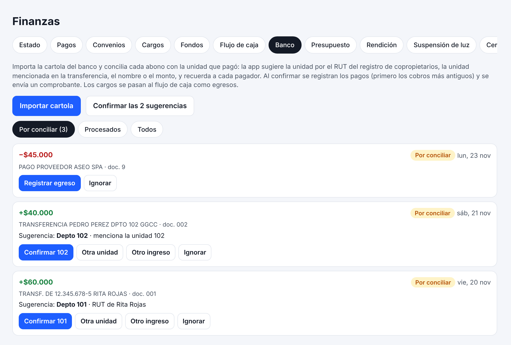

**Presupuesto.** En Finanzas → Presupuesto la administración define el presupuesto anual por categoría, con un monto por mes (puede partir del promedio gastado el año anterior). La app lo compara con los ítems de los gastos comunes publicados, mes a mes y en el año. La comunidad lo puede ver.

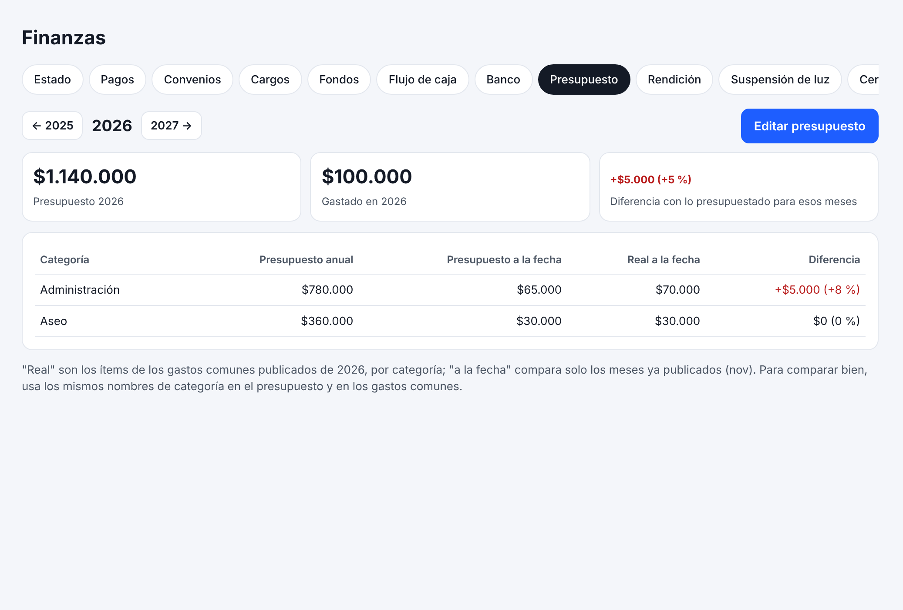

**Rendición de cuentas.** Finanzas → Rendición arma, para cada mes, el informe para la comunidad y el comité: gastos del período y su recaudación, ingresos y egresos con el saldo de caja, fondos, morosidad, presupuesto y estado de la conciliación bancaria; se imprime con espacio para las firmas.

**Flujo de caja.** Finanzas → Flujo de caja muestra, por mes y con totales del año, los ingresos por gastos comunes (tomados de los pagos registrados), otros ingresos, egresos, flujo neto y saldo acumulado; se exporta a Excel. Los egresos y otros ingresos los anota la administración; para partir con la caja real, anota un ingreso de categoría "Saldo inicial". Los ítems de un período de gastos comunes son lo que se cobra, no egresos: no entran solos al flujo.

## Visitas con QR

Al anunciar una visita, el residente obtiene un QR (con el nombre del edificio, la fecha y un código) que comparte como imagen, por ejemplo por WhatsApp. En conserjería se escanea con **Escanear QR**, o se escribe el código de 8 caracteres, y se abre la ficha de la visita para registrar el ingreso; al salir se escanea de nuevo para registrar la salida.

Al anunciar la visita se puede marcar que **necesita estacionamiento**. En Administración → Edificio se decide si en ese caso la patente es obligatoria, pensado para accesos con lectura automática de patentes (LPR). La patente se guarda normalizada (mayúsculas, sin espacios ni guiones). La app no se conecta a ningún sistema LPR: deja el dato disponible en la tabla `visitas`.

El QR no contiene datos personales, solo un código aleatorio. La lectura usa el lector de códigos del navegador cuando existe (Chrome en Android) y, si no (iPhone, Firefox), una librería incluida en `web/vendor/`. La cámara requiere HTTPS (paso 2).

## Estacionamientos de visita

- **Administración → Estacionamientos**: se crean los estacionamientos de visita (por ejemplo V1…V6), se indica cuáles están reservados (discapacidad, carga y descarga, etc.) y se configuran dos tiempos en minutos.
- **Conserjería** ve el tablero en el módulo Estacionamientos: toca uno libre para marcarlo ocupado y uno ocupado para liberarlo. Cada casilla muestra cuánto tiempo lleva y cambia de color al superar cada tiempo. Si una visita anunciada con estacionamiento registra su ingreso, la app lleva directo a elegirle un lugar.
- **Avisos**: al ocupar se avisa al residente con el tiempo máximo; al cumplirse el primer tiempo recibe una alerta; al cumplirse el segundo se informa a administración y comité, y el uso queda en la pestaña **Excedidos** como respaldo para cursar una multa según el reglamento. La app no calcula ni cobra multas.

La hora de inicio y de término las pone el servidor, no el teléfono de conserjería. Los tiempos se revisan cada 5 minutos.

## Reservas y horas bloqueadas

Cada espacio tiene su horario de apertura y cierre (o **abierto las 24 horas**), máximo de horas por reserva, anticipación y si requiere aprobación. Además se le pueden definir **horarios bloqueados cada semana**: los días, de qué hora a qué hora y el motivo (aseo, mantención, lo que sea). Pueden ser varios, también el mismo día. En esas horas nadie puede reservar: aparecen marcadas con el motivo, y la base de datos rechaza la reserva aunque se intente por fuera de la app. Todo se configura en Administración → Espacios.

Límites: las reservas y los bloqueos son por horas completas; el horario de apertura es el mismo todos los días (para cerrar antes un día, se usa un bloqueo); y no hay bloqueos de una fecha puntual.

## Encuestas y votaciones

El comité o la administración publican una pregunta con opciones, plazo opcional y, si corresponde, restringida a propietarios. Al crearla se elige el tipo, que después no se puede cambiar:

- **Sondeo de opinión**: cada unidad emite un voto. Nadie ve el voto de otra unidad: la app solo muestra totales.
- **Materia de asamblea**: el voto de cada unidad pesa según su **alícuota** (la que está en Administración → Unidades) y es **nominal**: la comunidad ve qué unidades apoyan cada opción, el porcentaje de derechos de cada una y cuánto ha participado. El comité y la administración pueden descargar el detalle en Excel, con las unidades que no votaron. Antes de votar, la app avisa que el voto no es secreto.

En ambos casos el voto es de la unidad, lo emite una cuenta con acceso aprobado a esa unidad y se puede cambiar mientras la votación esté abierta. La app no gestiona poderes ni verifica quórum o mayorías legales: entrega el resultado ponderado para que el comité lo use según la ley y el reglamento.

## Notificaciones

Avisos en el teléfono o computador cuando llega una encomienda o una visita, hay un mensaje nuevo, se registra un pago o algo queda por aprobar. Cada persona las activa en **Mi cuenta → Notificaciones**, en cada dispositivo. El servidor genera sus claves solo; no hay nada que configurar.

Requieren que la app esté publicada con HTTPS (paso 2) y que el computador del edificio tenga internet. En iPhone/iPad solo funcionan con la app agregada a la pantalla de inicio (iOS 16.4 o superior). El envío real a teléfonos no está probado por el proyecto.

## Correo

La app envía sola por correo los **avisos de cobro**: al publicar el gasto común, a cada unidad su monto, el vencimiento, el saldo anterior y los datos para transferir; un recordatorio antes del vencimiento y un aviso de atraso (una vez por período, solo a unidades con saldo y fuera de convenio, con los días que elija la administración); y un comprobante por cada pago registrado. Se activan o apagan en la misma tarjeta. Al actualizar, los períodos ya publicados no se reenvían.

También envía las **notificaciones formales**: cargos y resoluciones de multas, aviso previo y reposición de la suspensión de luz, citaciones a asamblea, el requerimiento anual del Registro de copropietarios y las respuestas a solicitudes sobre datos personales. Cada correo va al correo de la unidad en el Registro de copropietarios (el domicilio para notificaciones) y a las cuentas de la app de esa unidad, sin repetir a nadie, y sale a nombre del edificio. La administración ve cada envío con su fecha y estado, puede abrirlo, y reintentar o descartar los que fallen. Los envíos fallidos se reintentan solos, con esperas crecientes.

Se configura en **Administración → Edificio → Correo**, con una cuenta creada para el edificio:

- **Gmail**: activa la verificación en 2 pasos y crea una *contraseña de aplicación* (Cuenta de Google → Seguridad → Contraseñas de aplicaciones). Gmail gratuito permite unos 500 correos al día.
- **Outlook / Microsoft 365**: igual, con una contraseña de aplicación. Algunas cuentas de empresa tienen el SMTP desactivado.
- **Otro**: el servidor SMTP del dominio del edificio (puerto 587 con STARTTLS o 465 con TLS).

El botón "Enviar correo de prueba" confirma que funciona. La contraseña queda solo en `config.json` del computador del edificio y no vuelve a mostrarse. Si en **Datos del edificio** hay un correo distinto, las respuestas llegan ahí. En la instalación con Supabase se envían con una Edge Function que se configura una vez (paso 4 de [Instalación alternativa: Supabase](#instalación-alternativa-supabase)); mientras no esté, los correos quedan en la misma lista para abrirlos y enviarlos a mano. El envío por Gmail u Outlook reales no está probado por el proyecto (sí con un servidor SMTP de prueba).

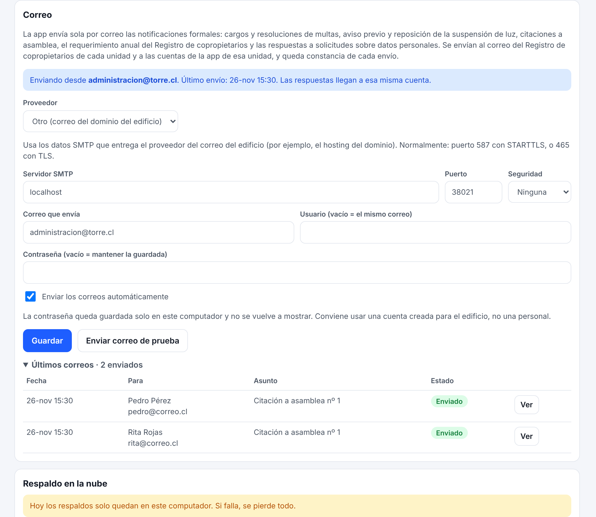

## Fotos y archivos

Se guardan en `local/datos/archivos`. Nadie puede abrirlos sin sesión: la app pide al servidor un enlace firmado que dura 1 hora, y el servidor solo lo entrega a quien puede leer ese archivo según su rol (por ejemplo, la foto de una encomienda la ven conserjería, administración y la unidad destinataria). Las imágenes se comprimen en el navegador a 1280 px antes de subir; el máximo por archivo es 15 MB.

## NFC

El escaneo de rondas usa **Web NFC**, disponible solo en Chrome para Android. Graba en cada tag un registro de texto con el código que pusiste en el activo (p. ej. `CHK-P12`). En otros dispositivos el conserje puede escribir el código o elegir el activo de la lista.

## Seguridad

El modelo de seguridad y sus limitaciones están en [`SECURITY.md`](SECURITY.md). Lo esencial: el computador que ejecuta el servidor guarda los datos de toda la comunidad, así que mantenlo actualizado, con contraseña y con acceso restringido, y respalda `local/datos`.

## Datos personales (Chile)

La app trata datos personales de residentes, trabajadores y visitas: nombre, teléfono, correo, unidad, RUT y patente de visitas, fotos, mensajes, votos y estado de pago de gastos comunes. En Chile eso está regulado por la Ley 19.628, reformada por la **Ley 21.719** (crea la Agencia de Protección de Datos Personales y multas de hasta 20.000 UTM). Su entrada en vigencia estaba fijada para el 1 de diciembre de 2026 y a noviembre de 2026 se tramitaba una postergación a octubre de 2027: verifica la fecha vigente.

Esto no es asesoría legal. El **responsable de los datos** es la comunidad de copropietarios (a través de su comité y administración), no este proyecto. Con la instalación local, los datos quedan en un equipo del edificio y no se entregan a un tercero.

Lo que la app ya trae para cumplir:

| Obligación | Cómo se cubre |
|---|---|
| Informar al titular | Aviso de privacidad del edificio (Administración → Edificio), mostrado y aceptado al registrarse. Queda como **consentimiento** con la fecha y el texto exacto aceptado, visible en Mi cuenta → Lo que aceptaste. |
| Ejercer derechos | Mi cuenta → **Ejercer tus derechos**: acceso, rectificación, supresión, oposición, portabilidad o bloqueo. La administración las ve en Administración → Datos personales con su plazo de 30 días corridos, y la persona recibe la respuesta en la app. |
| Minimizar quién ve qué | El teléfono de cada persona lo ven ella y la administración. Conserjería y comité lo consultan con el botón "📞 Teléfono de una unidad" indicando un motivo. |
| Registro de accesos y cambios | **Bitácora de auditoría** (Administración → Datos personales): quién creó, cambió, borró o consultó datos personales o de dinero, con su motivo. No se puede modificar; se exporta a Excel. Los votos no se registran, para no romper el secreto de los sondeos. Al eliminar una cuenta se borran sus datos también de la bitácora. |
| Acceso y portabilidad | Mi cuenta → **Descargar mis datos** (JSON). |
| Rectificación | Cada persona edita su nombre y teléfono; unidad y rol los corrige la administración. |
| Supresión | Mi cuenta → **Eliminar mi cuenta**: borra nombre, teléfono y unidad y bloquea el acceso. |
| Conservación limitada | Administración → Edificio → **Conservación de datos** (también la bitácora, con la clave `auditoria`): la administración fija cuántos meses se guardan visitas, rondas, encomiendas entregadas, mensajes, reservas, incidencias cerradas y uso de estacionamientos. Lo que supera el plazo se borra a diario, con sus fotos. |
| Seguridad y mínimo acceso | Permisos por rol; cada unidad ve solo sus cobros, encomiendas, visitas y voto. |

Lo que debe resolver cada comunidad (no lo hace el software):

1. Redactar su aviso de privacidad: quién es el responsable y cómo contactarlo, para qué se usan los datos, por cuánto tiempo se guardan y cómo ejercer los derechos. El texto por defecto es genérico.
2. Definir sus **plazos de conservación**. Mientras no se definan, nada se borra. Gastos comunes, pagos, comunicados, documentos, encuestas y órdenes de trabajo no tienen borrado automático.
3. Pedir a las visitas solo los datos necesarios; RUT y patente son opcionales en el formulario.
4. Tener un procedimiento para responder solicitudes de los titulares y para avisar a la Agencia y a los afectados si hay una filtración.
5. Decidir qué se sube a Documentos: todo residente del edificio puede leer lo que se publique ahí.
6. Cuidar el computador y los respaldos: quien tenga la carpeta `local/datos` tiene todos los datos. El respaldo en la nube va cifrado, pero queda en la cuenta personal o institucional de quien inició sesión en esa nube: decide de quién es esa cuenta.

## Instalación alternativa: Supabase

La misma app puede funcionar sobre un proyecto de [Supabase](https://supabase.com) en vez del servidor local, para quien prefiera no mantener un computador encendido:

1. Crea un proyecto, ejecuta `supabase/schema.sql` completo en el SQL Editor y habilita el proveedor *Email* en Authentication.
2. Copia *Project URL* y *anon public key* en `web/config.js` y sube la carpeta `web/` a un hosting estático (Vercel, Netlify, Cloudflare Pages).
3. Para notificaciones push: genera claves VAPID (`npx web-push generate-vapid-keys`), pon la pública en `config.js`, despliega `supabase/functions/push` con sus secretos (`VAPID_PUBLIC_KEY`, `VAPID_PRIVATE_KEY`, `VAPID_SUBJECT`, `PUSH_SECRET`) e indica su URL y secreto en la tabla `plataforma` (`push_url`, `push_secret`). Activa las extensiones `pg_net` y `pg_cron`.
4. Para enviar correos: despliega `supabase/functions/correos` (`supabase functions deploy correos --no-verify-jwt`) con los secretos `CORREO_SECRET` (un valor largo al azar), `CORREO_REMITENTE` y, para enviar, **o** `SMTP_HOST`, `SMTP_USER`, `SMTP_PASS` (puerto 465, por ejemplo Gmail con contraseña de aplicación: Supabase bloquea los puertos 25 y 587) **o** `RESEND_API_KEY` de [Resend](https://resend.com). Después indica su URL y el mismo secreto en la tabla `plataforma` (`correo_url`, `correo_secret`). pg_cron la llama cada minuto si hay correos pendientes. La prueba de la función está en `supabase/functions/correos/prueba.mjs` (necesita Deno); el envío por Resend no está probado.

Este modo comparte el esquema y sus pruebas con el modo local, pero **nunca se ha desplegado en un proyecto Supabase real**. Si tu Supabase es autoalojado, agrega su dominio en la política `connect-src` de `web/index.html`.

## Pruebas

- **Permisos, reglas y actualizaciones** (`supabase/tests/run.sh`): aplica el esquema en un Postgres y verifica instalación nueva, re-ejecución, permisos por rol y unidad, pagos y convenios, encuestas, avisos y archivos. Además actualiza desde el esquema de **cada versión publicada** (`supabase/tests/versiones/`), con datos, y comprueba que no se pierde nada.

  ```bash
  PGHOST=localhost PGUSER=postgres supabase/tests/run.sh
  ```

- **Servidor local** (`local/test.mjs`): levanta el servidor con datos temporales y lo usa por HTTP: cuentas, consultas, permisos, archivos, avisos de cambios, respaldo, persistencia, y que una actualización fallida no toque los datos.

  ```bash
  cd local && npm install && npm test
  ```

La CI ejecuta ambas en cada push y construye el instalador de Windows.

## Versiones

La versión vigente está en el archivo [`VERSION`](VERSION) y los cambios de cada una en [`CHANGELOG.md`](CHANGELOG.md). Al fusionar una versión nueva en `main`, el workflow `Release` crea la etiqueta y el release en GitHub.

## Próximos pasos sugeridos

1. Probarla en un edificio real, con túnel y notificaciones en teléfonos.
2. Firmar el instalador de Windows y dejar el servidor como servicio, para que parta sin iniciar sesión.
3. Respaldo con inicio de sesión directo en Google Drive o OneDrive, sin instalar su aplicación.
4. Pagos en línea e intereses por mora.

## Contribuir

Mi Edificio es software libre: úsalo, adáptalo a tu comunidad y envía mejoras. Lee [`CONTRIBUTING.md`](CONTRIBUTING.md) para conocer las reglas del proyecto. Las vulnerabilidades se reportan en privado desde *Security → Report a vulnerability*.

## Licencia

[MIT](LICENSE). El código de terceros incluido está descrito en [`web/vendor/README.md`](web/vendor/README.md).
